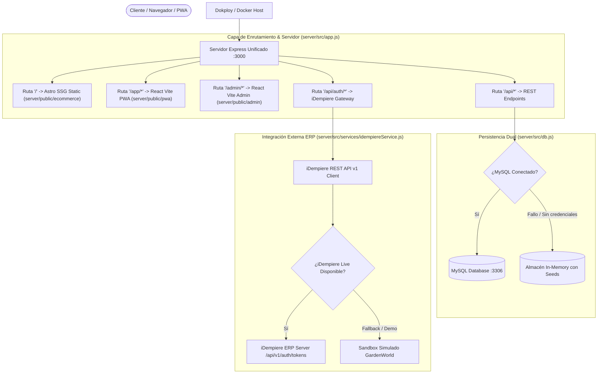
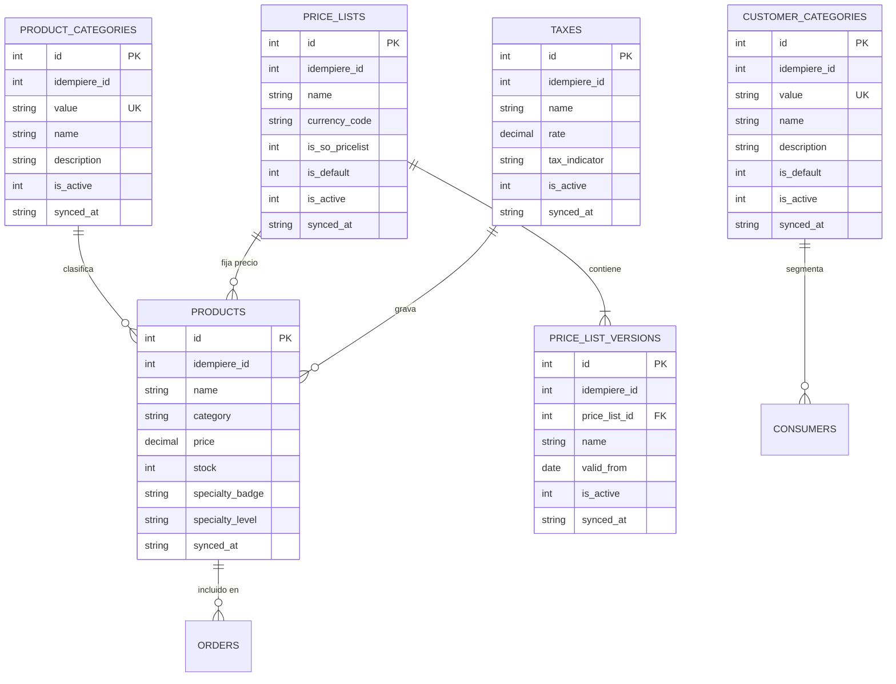
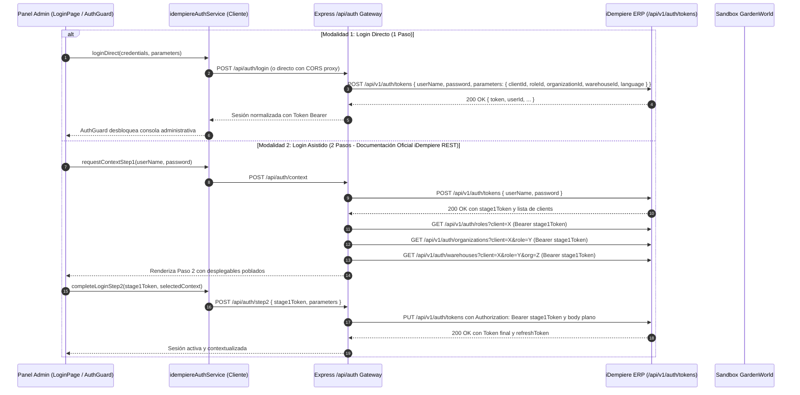
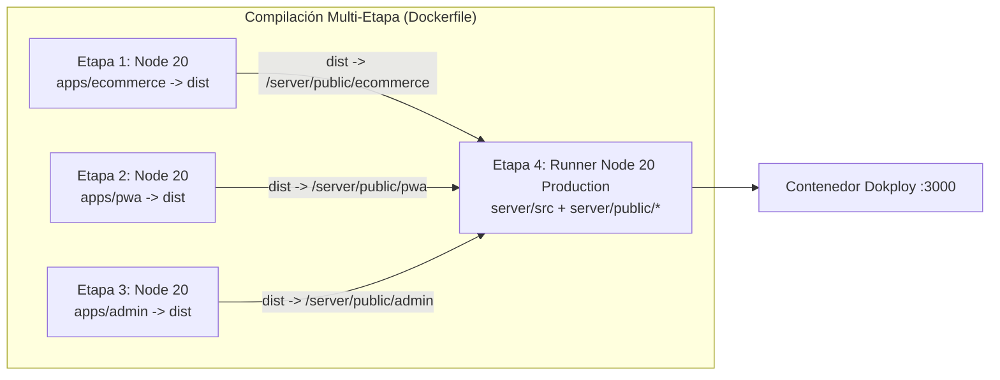

# 🏛️ Arquitectura del Sistema - Hamburger Rapid

Documento de especificación arquitectónica del repositorio monorepo **Hamburger Rapid** (NextCollege Scaffold & Masterclass Template).

---

## 1. Visión General y Topología

La plataforma está diseñada como un **Monorepo Desacoplado de 4 Capas** con un punto de entrada de ejecución unificado mediante un contenedor Docker multi-etapa o un servidor Node.js/Express.



---

## 2. Capas de la Aplicación

### 2.1. Capa 1: Landing E-commerce & Menú Digital (`apps/ecommerce`) [NO TOCAR]
* **Framework:** Astro 4 (`astro.config.mjs`, modo `output: 'static'`).
* **Propósito:** Catálogo comercial y menú interactivo de cara al público consumidor.
* **Diseño e Identidad Visual:** Basado en el flyer de diseño gastronómico en `assets_reference/images/Hamburguesa3.jpg`.
  * Paleta rústica oscura: Pizarra/madera (`#0d0e12`, `#13141a`, `#191b22`).
  * Acentos de alta energía: Naranja eléctrico (`#ff7a00`, `#ff8e1f`).
  * Tipografías: Outfit y Plus Jakarta Sans.
  * Formas geométricas: Recortes circulares para hamburguesas/bebidas con solapas orgánicas y botones tipo píldora (`border-radius: 9999px`).
* **Salida de Compilación:** Compila en `apps/ecommerce/dist` y se sincroniza a `server/public/ecommerce`. Servido en la raíz (`/`).

### 2.2. Capa 2: Aplicación Móvil PWA de Pedidos (`apps/pwa`) [NO TOCAR]
* **Framework:** React 18 + Vite (`apps/pwa/vite.config.js`).
* **Configuración Base:** `base: '/app/'` (vital para el correcto ruteo estático bajo Express).
* **Capacidades PWA:**
  * Service Worker (`sw.js`) y `manifest.json` para modo offline-first.
  * Captura de pedidos en ruta para vendedores y preventistas, carro de compras interactivo y geolocalización.
* **Salida de Compilación:** Compila en `apps/pwa/dist` y se sincroniza a `server/public/pwa`. Servido bajo el prefijo `/app`.

### 2.3. Capa 3: Panel Administrativo y Backoffice (`apps/admin`)
* **Framework:** React 18 + Vite (`apps/admin/vite.config.js`).
* **Configuración Base:** `base: '/admin/'`.
* **Seguridad y Control de Acceso (`AuthGuard`):**
  * Acceso universal: Permite el ingreso a **cualquier usuario con credenciales activas en iDempiere ERP** (sin restricción arbitraria por rol para acceder a la consola).
  * Persistencia de sesión en `sessionStorage` y `localStorage` (`token`, `userId`, `clientId`, `roleId`, `orgId` / `organizationId`, `warehouseId`, `language`).
  * `AuthGuard` modular que redirige inmediatamente al login si no hay token válido, y expone botón de **Cerrar Sesión**.
* **Modalidades de Autenticación iDempiere v1:**
  1. **Modalidad 1: Login Directo / 1 Paso:** Envía credenciales y parámetros de contexto en una sola solicitud atómica.
  2. **Modalidad 2: Login Asistido en 2 Pasos (Multitenant Dinámico):**
     * *Paso 1:* Envío exclusivo de `userName` y `password` para consultar tenants, roles, organizaciones y almacenes asignados.
     * *Paso 2:* Selección en desplegables dinámicos y confirmación para obtener el token Bearer definitivo.
* **Manejo de Conectividad y CORS:**
  * Selector en pantalla: **Proxy Backend Local** (vía Express `/api/auth/login`), **CORS Proxy Público** (`https://corsproxy.io/?`) o **REST Directo**.
  * URL base configurable (GardenWorld Live `https://test.idempiere.org:443` o local `http://localhost:8080`).
  * Botón de **"Cargar Demo GardenWorld"** y Acceso Rápido 1-Clic.
* **Bandeja Central de Gestión de Pedidos (`OrdersManagementView`):**
  * Articulación operativa de las 3 capas:
    * Filtrado por Origen: **📱 PWA Preventa / Vendedores** (con vendedor y ruta) vs **🛒 E-commerce Web** (pedidos directos).
    * Sincronización a iDempiere ERP: Generación de documento `C_Order` con trazabilidad del ID generado.
* **Biblioteca Base Reutilizable:** `idempiereAuthService.js` implementado sin dependencias acopladas para su futura importación en la PWA de Pedidos.
* **Salida de Compilación:** Compila en `apps/admin/dist` y se sincroniza a `server/public/admin`. Servido bajo el prefijo `/admin`.

### 2.4. Capa 4: Runtime Backend y API Gateway (`server`)
* **Runtime:** Node.js 20 LTS + Express.
* **Módulo Principal:** `server/src/app.js`.
* **Responsabilidades:**
  1. **Servidor Estático Multiruta:** Distribuye las 3 aplicaciones web SPA/SSG compiladas con soporte para fallback de páginas informativas.
  2. **API REST Unificada:** Proveedor de datos para catálogo, órdenes, métricas de consumo y sincronización ERP.
  3. **Gateway de Autenticación iDempiere ERP:** Puente robusto con saneamiento de parámetros (`/api/v1/auth/tokens`), soporte de 1 y 2 pasos y contingencia con Sandbox GardenWorld.

---

## 3. Arquitectura de Datos: SQLite 3 en Producción (WAL Mode)

En la presente fase se ha descartado definitivamente MySQL, adoptando **SQLite 3 (`better-sqlite3`)** como motor único de base de datos para producción y desarrollo local:

* **Ubicación Física:** `server/data/hamburger_rapid.sqlite` (con volumen persistente en Docker `/app/server/data`).
* **Concurrencia:** Habilitado en modo **WAL (`journal_mode = WAL`)** con escrituras atómicas síncronas normales (`synchronous = NORMAL`) y claves foráneas activas.
* **Modelo de Datos:** 8 tablas relacionales que soportan tanto el menú de hamburguesas como los 5 catálogos sincronizados desde iDempiere ERP:


```

### 3.1. Tablas y Estructura de Datos
* **`products`:** `id`, `name`, `category`, `price`, `stock`, `specialty_badge`, `specialty_level`, `rating`, `calories`, `prep_time`, `image`, `description`, `created_at`.
* **`consumers` (En memoria / Proyectado):** `id`, `name`, `email`, `tier` (`VIP`, `Medio`, `Ocasional`), `segment`, `orders_count`, `total_spent`, `favorite_burger`, `loyalty_points`.
* **`orders`:** `id`, `origin` (`'pwa'` | `'ecommerce'`), `channel`, `vendor`, `customer`, `items`, `total`, `status`, `idempiere_synced`, `idempiere_order_id`, `timestamp`, `address`, `payment`.

---

## 4. Integración Blindada con iDempiere ERP REST API v1

### 4.1. Flujo de Autenticación en 1 Paso vs 2 Pasos



### 4.2. Reglas Técnicas Obligatorias de iDempiere REST (Blindaje Técnico)
1. **Ruta en Plural:** La URL de obtención de tokens debe ser `/api/v1/auth/tokens` (el singular `/token` produce error 404).
2. **Propiedad `organizationId`:** En el payload JSON, el ID de organización debe enviarse estrictamente con la clave `organizationId`. El uso de `orgId` genera errores de deserialización Java en `com.trekglobal.idempiere.rest.api.v1.auth.LoginCredential`.
3. **Anidamiento de Parámetros:** `clientId`, `roleId`, `organizationId`, `warehouseId` y `language` deben ir dentro del subobjeto `parameters`.

---

## 5. Matriz de Endpoints de la API REST

| Método | Endpoint | Descripción | Componente Consumidor |
|---|---|---|---|
| `GET` | `/api/health` | Estado del servidor, tiempo activo y modo de BD (SQLite) | Admin, Dokploy, Monitoreo |
| `GET` | `/api/products` | Lista de productos (compatibilidad retroactiva) | Landing, PWA, Admin |
| `POST` | `/api/products` | Registro de nueva hamburguesa | Admin |
| `DELETE` | `/api/products/:id` | Eliminación de producto por ID | Admin |
| `POST` | `/api/reset` | Restablece catálogo original de hamburguesas | Admin |
| `GET` | `/api/catalogs/product-categories` | Catálogo de Categorías de Productos (M_Product_Category) | Admin, PWA |
| `POST` | `/api/catalogs/product-categories` | Crear categoría de producto (Mantenible) | Admin |
| `PUT` | `/api/catalogs/product-categories/:id` | Actualizar categoría de producto (Mantenible) | Admin |
| `DELETE` | `/api/catalogs/product-categories/:id` | Eliminar categoría de producto (Mantenible) | Admin |
| `GET` | `/api/catalogs/products` | Catálogo maestro de productos (M_Product) | Admin, PWA, Ecommerce |
| `POST` | `/api/catalogs/products` | Crear producto en catálogo maestro (Mantenible) | Admin |
| `PUT` | `/api/catalogs/products/:id` | Actualizar producto (Mantenible) | Admin |
| `DELETE` | `/api/catalogs/products/:id` | Eliminar producto (Mantenible) | Admin |
| `GET` | `/api/catalogs/price-lists` | Listas de precios y versiones (M_PriceList) | Admin, PWA |
| `POST` | `/api/catalogs/price-lists` | Crear lista de precios (Mantenible) | Admin |
| `PUT` | `/api/catalogs/price-lists/:id` | Actualizar lista de precios (Mantenible) | Admin |
| `DELETE` | `/api/catalogs/price-lists/:id` | Eliminar lista de precios (Mantenible) | Admin |
| `POST` | `/api/catalogs/price-lists/:id/versions` | Crear versión de lista de precios (Mantenible) | Admin |
| `DELETE` | `/api/catalogs/price-list-versions/:id` | Eliminar versión de lista de precios (Mantenible) | Admin |
| `GET` | `/api/catalogs/customer-categories` | Categorías de Clientes (C_BP_Group) | Admin, PWA |
| `POST` | `/api/catalogs/customer-categories` | Crear categoría de cliente (Mantenible) | Admin |
| `PUT` | `/api/catalogs/customer-categories/:id` | Actualizar categoría de cliente (Mantenible) | Admin |
| `DELETE` | `/api/catalogs/customer-categories/:id` | Eliminar categoría de cliente (Mantenible) | Admin |
| `GET` | `/api/catalogs/taxes` | Tasas impositivas (C_Tax) - **SOLO LECTURA** | Admin, PWA |
| `POST` | `/api/catalogs/sync-all` | Sincronización maestra de los 5 catálogos iDempiere hacia SQLite | Admin |
| `GET` | `/api/consumers` | Lista de consumidores registrados | Admin |
| `GET` | `/api/metrics/consumers` | Métricas agregadas y segmentación de clientes | Admin |
| `GET` | `/api/orders` | Historial de pedidos unificados (PWA y E-commerce) | PWA, Admin |
| `POST` | `/api/orders` | Creación de orden (desde PWA o E-commerce) | PWA, E-commerce |
| `PATCH` | `/api/orders/:id/status` | Actualización de estado operativo del pedido | Admin |
| `POST` | `/api/orders/:id/sync-erp` | Sincroniza pedido a iDempiere ERP y genera C_Order | Admin |
| `POST` | `/api/auth/login` | Login directo en 1 paso contra iDempiere ERP | Admin, PWA |
| `POST` | `/api/auth/context` | Consulta de contexto multitenant (Paso 1) | Admin, PWA |
| `POST` | `/api/auth/step2` | Confirmación en 2 pasos (PUT /tokens) oficial | Admin, PWA |
| `POST` | `/api/auth/verify` | Validación del token de sesión | Admin |
| `GET` | `/api/auth/config` | Configuración y credenciales demo GardenWorld | Admin |
| `POST` | `/api/auth/test-connection` | Comprobación de alcance a URL de iDempiere | Admin |

---

## 6. Pipeline de Construcción y Despliegue (CI/CD & Docker)

El `Dockerfile` utiliza compilación multi-etapa para generar una imagen ligera y lista para producción:


