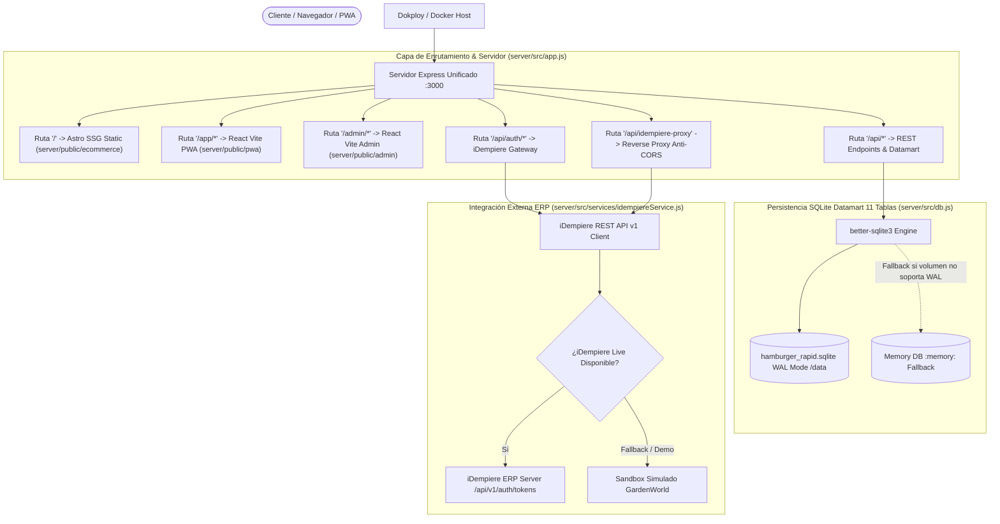
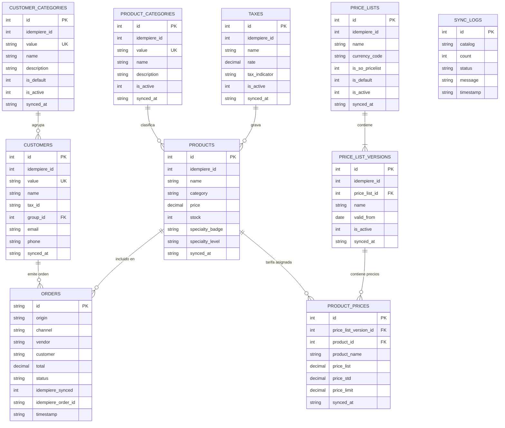
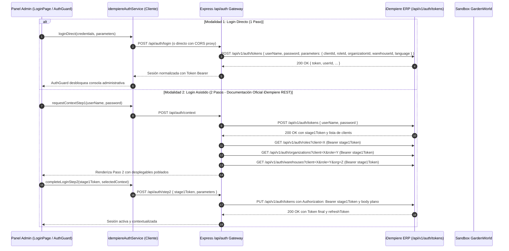
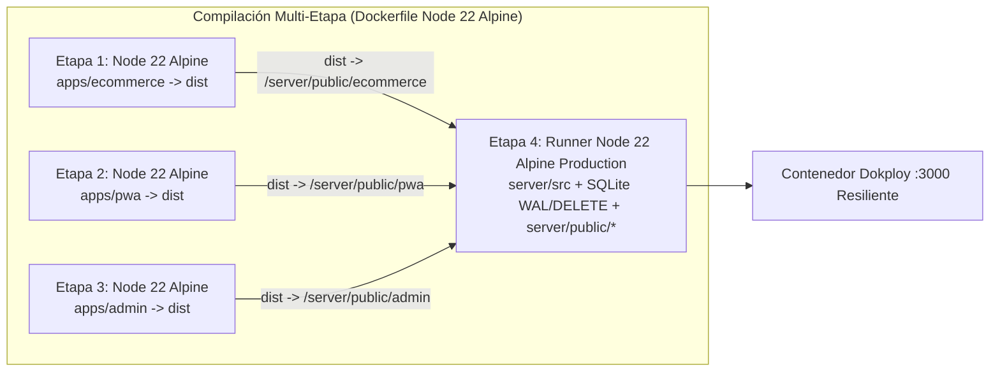

# 🏛️ Arquitectura del Sistema - Hamburger Rapid

Documento de especificación arquitectónica del repositorio monorepo **Hamburger Rapid** (NextCollege Scaffold & Masterclass Template).

---

## 1. Visión General y Topología

La plataforma está diseñada como un **Monorepo Desacoplado de 4 Capas** con un punto de entrada de ejecución unificado mediante un contenedor Docker multi-etapa o un servidor Node.js/Express.



---

## 2. Capas de la Aplicación

### 2.1. Capa 1: Landing E-commerce & Menú Digital (`apps/ecommerce`) [NO TOCAR]
* **Framework:** Astro 4 (`astro.config.mjs`, modo `output: 'static'`).
* **Propósito:** Catálogo comercial y menú interactivo de cara al público consumidor.
* **Diseño e Identidad Visual:** Basado en el flyer de diseño gastronómico en `assets_reference/images/Hamburguesa3.jpg`.
  * Paleta rústica oscura: Pizarra/madera (`#0d0e12`, `#13141a`, `#191b22`).
  * Acentos de alta energía: Naranja eléctrico (`#ff7a00`, `#ff8e1f`).
  * Tipografías: Outfit y Plus Jakarta Sans.
  * Formas geométricas: Recortes circulares para hamburguesas/bebidas con solapas orgánicas y botones tipo píldora (`border-radius: 9999px`).
* **Salida de Compilación:** Compila en `apps/ecommerce/dist` y se sincroniza a `server/public/ecommerce`. Servido en la raíz (`/`).

### 2.2. Capa 2: Aplicación Móvil PWA de Pedidos (`apps/pwa`) [NO TOCAR]
* **Framework:** React 18 + Vite (`apps/pwa/vite.config.js`).
* **Configuración Base:** `base: '/app/'` (vital para el correcto ruteo estático bajo Express).
* **Capacidades PWA:**
  * Service Worker (`sw.js`) y `manifest.json` para modo offline-first.
  * Captura de pedidos en ruta para vendedores y preventistas, carro de compras interactivo y geolocalización.
* **Salida de Compilación:** Compila en `apps/pwa/dist` y se sincroniza a `server/public/pwa`. Servido bajo el prefijo `/app`.

### 2.3. Capa 3: Panel Administrativo y Backoffice (`apps/admin`)
* **Framework:** React 18 + Vite (`apps/admin/vite.config.js`).
* **Configuración Base:** `base: '/admin/'`.
* **Diseño y Shell Modular (`SidebarNavbar` & `DashboardLayout`):**
  * **SidebarNavbar Colapsable:** Barra lateral con Phosphor & Lucide vectors, modo abierto (`240px`) con Company Switcher, secciones (*General, Comercial, Operaciones, Finanzas, Sistema*), badges numéricos y modo colapsado (`56px`) persistente en `localStorage`.
  * **Top Header Bar:** Barra superior fija con pill de usuario, selector de proxy, botón modal *Token Info* y switch de temas.
  * **14 Subvistas Especializadas:**
    1. `OrderManagement.jsx`: Bandeja de pedidos con filtrado PWA vs E-commerce y modal payload `C_Order`.
    2. `GeneralSummaryView.jsx`: Dashboard ejecutivo con KPIs y balance de clientes.
    3. `BurgerCatalogView.jsx`: Catálogo visual de las 10 hamburguesas insignia y ajuste de stock.
    4. `CustomerMetricsView.jsx`: Segmentación y métricas de consumo (VIP Gold, Regular, Ocasional).
    5. `ProductCategoriesView.jsx`: Mantenimiento y sincronización de `M_Product_Category`.
    6. `ProductsView.jsx`: Mantenimiento y sincronización de `M_Product`.
    7. `PriceListsView.jsx`: Listas, versiones y asignación de precios `M_PriceList` / `M_ProductPrice`.
    8. `CustomerCategoriesView.jsx`: Mantenimiento y sincronización de `C_BP_Group`.
    9. `CustomersView.jsx`: Mantenimiento y sincronización de `C_BPartner`.
    10. `TaxesView.jsx`: Catálogo fiscal `C_Tax` (**Estricto Solo Lectura**).
    11. `DatabaseStatusView.jsx`: Telemetría de SQLite Datamart, historial de sincronización y sincronización masiva en 1 clic.
    12. `IDempiereIntegrationView.jsx`: Consola de diagnóstico Live Ping en milisegundos.
    13. `ProfileConfigView.jsx`: Parámetros de sesión y selector de modo 1-paso / 2-pasos.
    14. `TokenInfoModal.jsx`: Inspector forense de tokens Bearer y contexto multitenant.
* **Seguridad y Control de Acceso (`AuthGuard`):**
  * Acceso universal: Permite el ingreso a **cualquier usuario con credenciales activas en iDempiere ERP** (sin restricción arbitraria por rol para acceder a la consola).
  * Persistencia de sesión en `sessionStorage` y `localStorage` (`token`, `userId`, `clientId`, `roleId`, `orgId` / `organizationId`, `warehouseId`, `language`).
  * `AuthGuard` modular no bloqueante que renderiza el login ante sesión inactiva y desbloquea el backoffice ante sesión válida.
* **Modalidades de Autenticación iDempiere v1:**
  1. **Modalidad 1: Login Directo / 1 Paso:** Envía credenciales y parámetros de contexto en una sola solicitud atómica (`POST /api/v1/auth/tokens`).
  2. **Modalidad 2: Login Asistido en 2 Pasos (Multitenant Dinámico Oficial bxservice):**
     * *Paso 1:* Envío exclusivo de `userName` y `password` para consultar tenants, roles, organizaciones y almacenes asignados.
     * *Paso 2:* Selección en desplegables dinámicos y emisión de token vía `PUT /api/v1/auth/tokens` con `Authorization: Bearer <stage1Token>`.
* **Manejo de Conectividad y CORS:**
  * Selector en pantalla: **Proxy Backend Local** (vía Express `/api/auth/login`), **CORS Proxy Público** (`https://corsproxy.io/?`) o **REST Directo**.
  * URL base configurable (`https://test.idempiere.org` o `http://localhost:8080`).
  * Botón de **"Cargar Demo GardenWorld"** y Acceso Rápido 1-Clic.
* **Salida de Compilación:** Compila en `apps/admin/dist` y se sincroniza a `server/public/admin`. Servido bajo el prefijo `/admin`.

### 2.4. Capa 4: Runtime Backend y API Gateway (`server`)
* **Runtime:** Node.js 22 LTS (Alpine en Docker) + Express.
* **Módulo Principal:** `server/src/app.js`.
* **Responsabilidades:**
  1. **Servidor Estático Multiruta:** Distribuye las 3 aplicaciones web SPA/SSG compiladas con soporte para fallback de páginas informativas.
  2. **API REST Unificada & Datamart:** Proveedor de datos para catálogo, órdenes, métricas de consumo y sincronización ERP.
  3. **Proxy Anti-CORS Server-to-Server:** `/api/idempiere-proxy?target=` reenviando peticiones seguras al ERP.
  4. **Gateway de Autenticación iDempiere ERP:** Puente robusto con saneamiento de parámetros (`/api/v1/auth/tokens`), soporte de 1 y 2 pasos y contingencia con Sandbox GardenWorld.

---

## 3. Arquitectura de Datos: SQLite 3 en Producción (WAL Mode)

En la presente fase se ha descartado definitivamente MySQL, adoptando **SQLite 3 (`better-sqlite3`)** como motor único de base de datos para producción y desarrollo local:

* **Ubicación Física:** `server/data/hamburger_rapid.sqlite` (con volumen persistente en Docker `/app/server/data`).
* **Concurrencia:** Habilitado en modo **WAL (`journal_mode = WAL`)** con escrituras atómicas síncronas normales (`synchronous = NORMAL`) y claves foráneas activas (`foreign_keys = ON`), con degradación transparente a `DELETE` o `:memory:` si el volumen del host no admite memoria compartida POSIX.
* **Modelo de Datos:** 11 tablas relacionales que soportan el menú de hamburguesas, clientes, órdenes y los 6 catálogos sincronizados desde iDempiere ERP:


```

### 3.1. Tablas y Estructura de Datos
* **`products`:** `id`, `name`, `category`, `price`, `stock`, `specialty_badge`, `specialty_level`, `rating`, `calories`, `prep_time`, `image`, `description`, `created_at`.
* **`consumers` (En memoria / Proyectado):** `id`, `name`, `email`, `tier` (`VIP`, `Medio`, `Ocasional`), `segment`, `orders_count`, `total_spent`, `favorite_burger`, `loyalty_points`.
* **`orders`:** `id`, `origin` (`'pwa'` | `'ecommerce'`), `channel`, `vendor`, `customer`, `items`, `total`, `status`, `idempiere_synced`, `idempiere_order_id`, `timestamp`, `address`, `payment`.

---

## 4. Integración Blindada con iDempiere ERP REST API v1

### 4.1. Flujo de Autenticación en 1 Paso vs 2 Pasos



### 4.2. Reglas Técnicas Obligatorias de iDempiere REST (Blindaje Técnico)
1. **Ruta en Plural:** La URL de obtención de tokens debe ser `/api/v1/auth/tokens` (el singular `/token` produce error 404).
2. **Propiedad `organizationId`:** En el payload JSON, el ID de organización debe enviarse estrictamente con la clave `organizationId`. El uso de `orgId` genera errores de deserialización Java en `com.trekglobal.idempiere.rest.api.v1.auth.LoginCredential`.
3. **Anidamiento de Parámetros:** `clientId`, `roleId`, `organizationId`, `warehouseId` y `language` deben ir dentro del subobjeto `parameters`.

---

## 5. Matriz de Endpoints de la API REST

| Método | Endpoint | Descripción | Componente Consumidor |
|---|---|---|---|
| `GET` | `/api/health` | Estado del servidor, tiempo activo y telemetría de BD (SQLite WAL) | Admin, Dokploy, Monitoreo |
| `GET` | `/api/products` | Catálogo de hamburguesas gourmet (M_Product) | Landing, PWA, Admin |
| `POST` | `/api/products` | Registro de nuevo producto | Admin |
| `PUT` | `/api/products/:id` | Actualización de producto | Admin |
| `DELETE` | `/api/products/:id` | Eliminación de producto | Admin |
| `POST` | `/api/reset` | Restablece catálogo original de hamburguesas de autor | Admin |
| `GET` | `/api/product-categories` | Catálogo de Categorías de Productos (M_Product_Category) | Admin, PWA |
| `POST` | `/api/product-categories` | Crear categoría de producto | Admin |
| `PUT` | `/api/product-categories/:id` | Actualizar categoría de producto | Admin |
| `DELETE` | `/api/product-categories/:id` | Eliminar categoría de producto | Admin |
| `GET` | `/api/price-lists` | Listas de precios (M_PriceList) | Admin, PWA |
| `POST` | `/api/price-lists` | Crear lista de precios | Admin |
| `PUT` | `/api/price-lists/:id` | Actualizar lista de precios | Admin |
| `DELETE` | `/api/price-lists/:id` | Eliminar lista de precios | Admin |
| `GET` | `/api/price-list-versions` | Versiones de listas de precios (M_PriceList_Version) | Admin |
| `GET` | `/api/product-prices` | Precios específicos por versión (M_ProductPrice) | Admin |
| `POST` | `/api/product-prices` | Asignar precio de producto | Admin |
| `PUT` | `/api/product-prices/:id` | Actualizar precio de producto | Admin |
| `DELETE` | `/api/product-prices/:id` | Eliminar precio de producto | Admin |
| `GET` | `/api/customer-categories` | Categorías de Clientes (C_BP_Group) | Admin, PWA |
| `POST` | `/api/customer-categories` | Crear categoría de cliente | Admin |
| `PUT` | `/api/customer-categories/:id` | Actualizar categoría de cliente | Admin |
| `DELETE` | `/api/customer-categories/:id` | Eliminar categoría de cliente | Admin |
| `GET` | `/api/customers` | Clientes / Terceros (C_BPartner) | Admin |
| `POST` | `/api/customers` | Registrar nuevo cliente | Admin |
| `PUT` | `/api/customers/:id` | Actualizar cliente | Admin |
| `DELETE` | `/api/customers/:id` | Eliminar cliente | Admin |
| `GET` | `/api/taxes` | Catálogo fiscal (C_Tax) - **SOLO LECTURA** | Admin, PWA |
| `ALL` | `/api/taxes/*` | Bloqueo estricto de mutaciones (Retorna HTTP 405 Method Not Allowed) | Seguridad |
| `POST` | `/api/sync/:catalog` | Sincronización transaccional de catálogo desde iDempiere ERP | Admin |
| `GET` | `/api/sync/logs` | Historial de auditoría y registros de sincronización | Admin |
| `ALL` | `/api/idempiere-proxy?target=` | Reverse Proxy Server-to-Server para esquivar bloqueos de CORS | Admin, Frontend |
| `GET` | `/api/consumers` | Lista de consumidores registrados | Admin |
| `GET` | `/api/metrics/consumers` | Métricas agregadas y segmentación de clientes | Admin |
| `GET` | `/api/orders` | Historial de pedidos unificados (PWA y E-commerce) | PWA, Admin |
| `POST` | `/api/orders` | Creación de orden (desde PWA o E-commerce) | PWA, E-commerce |
| `PATCH` | `/api/orders/:id/status` | Actualización de estado operativo del pedido | Admin |
| `POST` | `/api/orders/:id/sync-erp` | Sincroniza pedido a iDempiere ERP y genera C_Order | Admin |
| `POST` | `/api/auth/login` | Login directo en 1 paso contra iDempiere ERP | Admin, PWA |
| `POST` | `/api/auth/context` | Consulta de contexto multitenant (Paso 1) | Admin, PWA |
| `POST` | `/api/auth/step2` | Confirmación en 2 pasos (PUT /tokens) oficial | Admin, PWA |
| `POST` | `/api/auth/verify` | Validación del token de sesión | Admin |
| `GET` | `/api/auth/config` | Configuración y credenciales demo GardenWorld | Admin |
| `POST` | `/api/auth/test-connection` | Comprobación de alcance a URL de iDempiere | Admin |

---

## 6. Pipeline de Construcción y Despliegue (CI/CD & Docker)

El `Dockerfile` utiliza compilación multi-etapa sobre **Node 22 Alpine** para compatibilidad estricta con motores nativos (`better-sqlite3@13.2.0`), garantizando resiliencia absoluta contra caídas y eliminando cualquier posibilidad de error HTTP 502 Bad Gateway:


